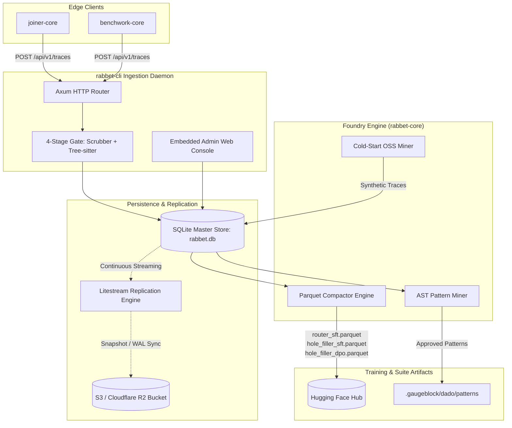
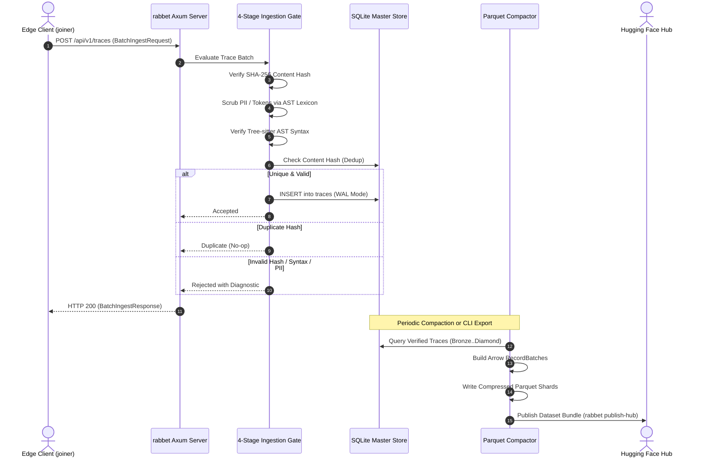

# `rabbet` — System Architecture

> **Domain:** Telemetry Corpus Hub & Training Foundry | **Suite:** `gaugeblock`

This document outlines the architectural components, subsystem interactions, and data storage workflows of `rabbet`.

---

## 1. System Decomposition

---

## 2. Ingestion & Compaction Sequence

---

## 3. Storage Architecture

* **Primary Single Source of Truth:** Embedded SQLite database (`rabbet.db`) running in Write-Ahead Logging (`WAL`) mode with `NORMAL` synchronous pragma. Indexed on `content_hash (UNIQUE)`, `tier`, `language`, and `created_at`.
* **Zero-Downtime Backup & Replication:** Uses Litestream to stream WAL segments directly to object storage (AWS S3, Cloudflare R2, MinIO), guaranteeing Point-In-Time Recovery without heavy relational database administration.
* **Columnar Sharding for Deep Learning:** Parquet files are generated using Apache Arrow `RecordBatch` streams with `SNAPPY` compression. This achieves $\sim 8\times$ compression over raw JSON and enables memory-mapped multi-GPU training loaders in PyTorch.

---

## 4. Crate & Package Topology

| Crate | Path | Responsibility |
|:---|:---|:---|
| [`rabbet`](./src/lib.rs) | `.` | Root facade re-exporting `rabbet_core` domain APIs |
| [`rabbet-cli`](./crates/rabbet-cli) | `crates/rabbet-cli` | Axum HTTP server, static asset embedding (`rust-embed`), Clap CLI |
| [`rabbet-core`](./crates/rabbet-core) | `crates/rabbet-core` | Schemas, SQLite repository, Tree-sitter AST validator, Arrow compactor, OSS & pattern miners |
