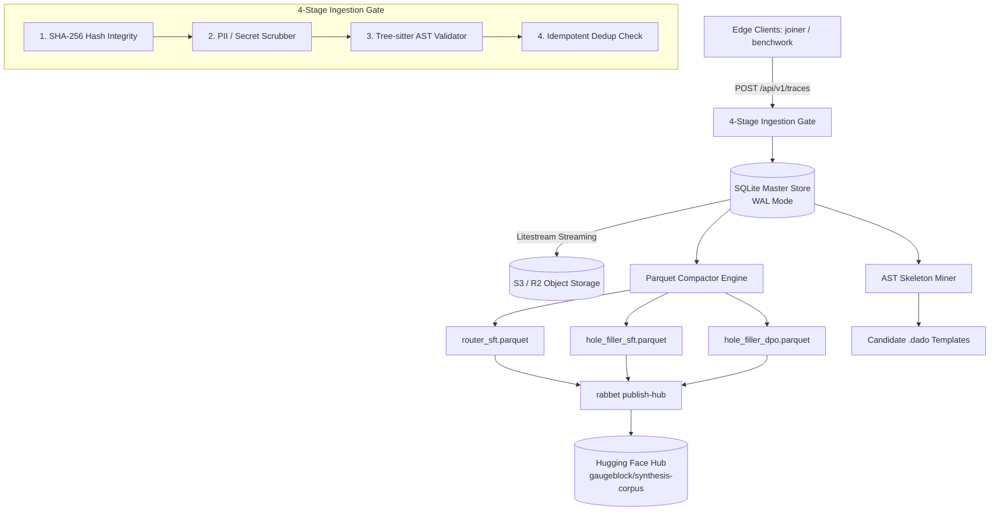

# `rabbet` — Telemetry Corpus Hub & Open-Weight Training Foundry

[](https://gaugeblock.dev)
[](LICENSE)
[](https://github.com/gaugeblock)
[](ARCHITECTURE.md)

Part of the **[`gaugeblock`](https://gaugeblock.dev)** neurosymbolic code synthesis ecosystem.

> In woodworking, a **rabbet** (or rebate) is a stepped rectangular recess cut along the edge or face of a workpiece, providing a clean ledge into which another element fits flush and secure (such as window panes or cabinet backing). In `gaugeblock`, `rabbet` is the central telemetry hub and fine-tuning foundry: it provides the secure recess into which compiler-verified synthesis traces from edge clients (`joiner`, `benchwork`) are safely seated, scrubbed of PII and secrets, indexed in SQLite with Litestream streaming replication, and compacted into Apache Arrow/Parquet SFT and DPO datasets for open-weight model training.

---

## 1. Why `rabbet`?

| Capability | Ad-Hoc Code Scraping | With `rabbet` |
|:---|:---|:---|
| **Data Quality** | Scraped GitHub code with syntax errors and broken types | **100% compiler-verified** AST synthesis targets (`Bronze` $\to$ `Diamond`) |
| **Privacy & Security** | Leaked API keys, internal credentials, PII in prompts | **4-stage ingestion gate** with strict AST scrubbing and secret redaction |
| **DPO Preferences** | Synthetic or ungrounded reward modeling | **Real compiler-guided DPO pairs** (rejected broken attempt vs. verified chosen) |
| **Pattern Discovery** | Manual rule authoring based on developer intuition | **Automated AST skeleton clustering** discovering reusable `dado` templates |
| **Storage & Training** | Heavy distributed DBs or uncompressed JSON Lines | **SQLite + Litestream** master store, Arrow RecordBatch $\to$ Parquet shards |
| **Open Weight Ecosystem** | Proprietary closed APIs and hidden training data | **Direct Hugging Face Hub publication** for community fine-tuning |

---

## 2. Ingestion & Foundry Pipeline



---

## 3. CLI Command Reference

The `rabbet` binary exposes complete server, mining, compaction, and administrative commands:

| Command | Subcommands / Flags | Purpose |
|:---|:---|:---|
| `rabbet serve` | `--port`, `--host`, `--db-path`, `--admin-token` | Starts the telemetry ingestion HTTP server and web dashboard |
| `rabbet mine-oss` | `--path`, `--db-path`, `--max-traces` | Mines synthetic `(Scope + Hole -> Expr)` pairs from OSS codebases |
| `rabbet export-parquet` | `--db-path`, `--output-dir` | Compiles and exports the 3 canonical Parquet dataset shards |
| `rabbet mine-patterns` | `--db-path`, `--min-frequency`, `--output-dir` | Discovers and clusters recurring AST patterns from Gold traces |
| `rabbet publish-hub` | `--bundle-dir`, `--repo-id`, `--token`, `--dry-run` | Packages and publishes Parquet shards to Hugging Face Hub |
| `rabbet admin` | *Subcommands below* | Executes maintainer control plane operations via CLI |
| `rabbet admin stats` | *(none)* | Displays summary corpus statistics across tiers and languages |
| `rabbet admin compact` | `--output-dir` | Triggers immediate Parquet compaction from SQLite |
| `rabbet admin candidates` | *(none)* | Lists discovered pattern candidates mined from Gold traces |
| `rabbet admin approve` | `--candidate-id`, `--output-dir` | Approves a mined pattern candidate and exports to `.dado` format |

---

## 4. Crate Topology

| Crate | Path | Responsibility |
|:---|:---|:---|
| [`rabbet`](./src/lib.rs) | `.` | Root facade crate re-exporting `rabbet-core` |
| [`rabbet-core`](./crates/rabbet-core) | `crates/rabbet-core` | Telemetry schemas, SQLite store, Arrow compactor, pattern miner |
| [`rabbet-cli`](./crates/rabbet-cli) | `crates/rabbet-cli` | Axum HTTP server, Clap CLI entrypoint, and embedded admin UI |

---

## 5. Quickstart

```bash
# 1. Install rabbet CLI globally
cargo install --path crates/rabbet-cli

# 2. Launch the telemetry ingestion server
rabbet serve --port 8080 --host 0.0.0.0 --db-path rabbet.db

# 3. Mine synthetic training data from local open-source crates
rabbet mine-oss --path ../miter --max-traces 5000 --db-path rabbet.db

# 4. Compile Parquet dataset shards for SFT and DPO training
rabbet export-parquet --db-path rabbet.db --output-dir dist/parquet

# 5. Inspect corpus telemetry statistics
rabbet admin stats --db-path rabbet.db

# 6. Publish dataset release to Hugging Face Hub
rabbet publish-hub --bundle-dir dist/parquet --repo-id gaugeblock/synthesis-corpus --dry-run
```

---

## 6. Repository Documentation

`rabbet` adheres strictly to the canonical **9-Document Architecture**:
* **[`README.md`](./README.md):** Project overview, comparative analysis, CLI reference, and architecture diagram.
* **[`SPEC.md`](./SPEC.md):** Formal wire contracts, boundary types, 4-stage gate invariants, and Parquet column schemas.
* **[`ARCHITECTURE.md`](./ARCHITECTURE.md):** Subsystem decomposition, Litestream replication, and compaction flows.
* **[`DESIGN.md`](./DESIGN.md):** Concrete Architectural Decision Records (ADRs).
* **[`PRODUCT.md`](./PRODUCT.md):** Personas, user journeys, JTBD, and open-weight training value proposition.
* **[`CONTRIBUTING.md`](./CONTRIBUTING.md):** Rust 2024 toolchain requirements and tiered verification gates.
* **[`ROADMAP.md`](./ROADMAP.md):** Active milestones and upcoming training foundry capabilities.
* **[`CHANGELOG.md`](./CHANGELOG.md):** Historical version releases and pending changes.
* **[`AGENTS.md`](./AGENTS.md):** Non-negotiable engineering laws and autonomous execution directives.

---

## 7. License

Licensed under the Apache License, Version 2.0 ([`LICENSE`](./LICENSE)).
