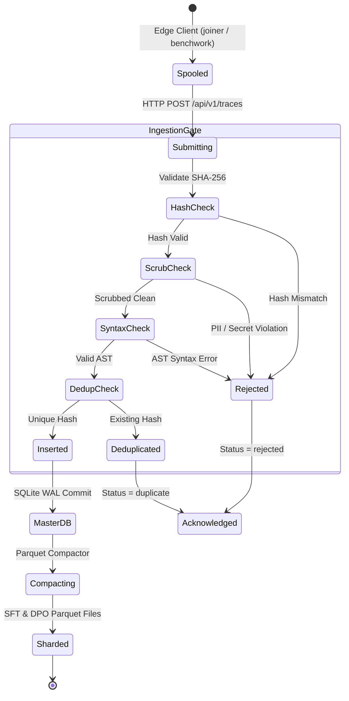

# `rabbet` — Behavioral Specifications & Invariants

> **Status:** Active Standard | **Domain:** Telemetry Corpus Hub & Training Foundry | **Suite:** `gaugeblock`

This specification defines the formal wire contracts, behavioral invariants, data ingestion gates, and Arrow/Parquet dataset schemas for `rabbet`.

---

## 1. Behavioral Invariants

### Invariant 1: 4-Stage Telemetry Ingestion Gate
All telemetry submitted to `POST /api/v1/traces` MUST pass four sequential validation gates:
1. **Content Hash Integrity:** The SHA-256 hash provided in `SpoolEntry.content_hash` MUST match the computed SHA-256 digest of the canonical JSON trace payload. Mismatches are rejected with HTTP 400 (`HashMismatch`).
2. **PII & Secret Scrubbing Gate:** Scopes and expressions MUST NOT contain raw secrets, API tokens, passwords, or unscrubbed local filesystem paths. Identifier tokens MUST conform to the anonymized lexicon.
3. **Tree-sitter AST Syntax Gate:** Expressions in `filled_holes` MUST parse cleanly under the Tree-sitter grammar for the target `language` with zero `ERROR` AST nodes.
4. **Idempotent SQLite Deduplication:** Traces are indexed by `content_hash`. Duplicate submissions are acknowledged as `duplicates` without error and without duplicating database storage.

### Invariant 2: Dynamic Quality Tier Hierarchy
Synthesis traces are categorized into four strictly ordered quality tiers:
* **`Bronze`:** Synthesized code compiled and passed static typechecking on attempt #1.
* **`Silver`:** Synthesized code passed all unit and integration test assertions on attempt #1.
* **`Gold`:** Synthesized code failed initial attempt but was resolved via iterative repair or Oracle fallback. Contains both `rejected_attempt` (with compiler diagnostic) and verified `filled_holes`, creating an empirical DPO training pair.
* **`Diamond`:** Synthesized code survived unchanged in repository `main` branch across subsequent commits.

### Invariant 3: Parquet Shard Schema Integrity
Exported Arrow RecordBatches and Parquet files MUST conform to fixed columnar schemas:
* **`router_sft.parquet`:** Columns `[trace_id: string, language: string, scope_signature: string, selected_pattern_id: string, tier: string]`.
* **`hole_filler_sft.parquet`:** Columns `[trace_id: string, language: string, scope_signature: string, hole_id: string, filled_expression: string, tier: string]`.
* **`hole_filler_dpo.parquet`:** Columns `[trace_id: string, language: string, prompt: string, chosen: string, rejected: string, diagnostic_code: string, diagnostic_message: string]`.

---

## 2. Ingestion & Processing State Machine

---

## 3. Formal Type Contracts

The following 25 types define the complete public and boundary interface for `rabbet`:

| Type Name | Kind | Crate / Module | Description |
|:---|:---|:---|:---|
| **`AdminArgs`** | `struct` | `rabbet_cli::args` | CLI arguments for `rabbet admin` maintainer control plane |
| **`AdminSubcommand`** | `enum` | `rabbet_cli::args` | Maintainer actions (`Stats`, `Compact`, `Candidates`, `Approve`) |
| **`AnonymizedSynthesisTrace`** | `struct` | `rabbet_core::model` | Canonical wire contract for compiler-verified synthesis telemetry |
| **`AppState`** | `struct` | `rabbet_cli::server` | Shared Axum state handle wrapping `MasterStore` and config |
| **`BatchIngestRequest`** | `struct` | `rabbet_core::model` | Public batch ingest submission payload for `POST /api/v1/traces` |
| **`BatchIngestResponse`** | `struct` | `rabbet_core::model` | Ingestion result summary (`accepted`, `duplicates`, `rejected`) |
| **`Cli`** | `struct` | `rabbet_cli::args` | Top-level Clap command-line parser definition |
| **`ColdMinerOptions`** | `struct` | `rabbet_core::miner` | Configuration options for cold-start OSS code extraction |
| **`Command`** | `enum` | `rabbet_cli::args` | Top-level CLI command router enum |
| **`CompilerDiagnostic`** | `struct` | `rabbet_core::model` | Compiler error/warning message emitted during verification |
| **`CorpusStats`** | `struct` | `rabbet_core::model` | High-level corpus metrics across tiers, languages, and storage |
| **`ExportParquetArgs`** | `struct` | `rabbet_cli::args` | Arguments for Parquet dataset compaction command |
| **`IngestResultDetail`** | `struct` | `rabbet_core::model` | Per-trace evaluation outcome detail in batch response |
| **`MasterStore`** | `struct` | `rabbet_core::db` | Thread-safe SQLite master store handle with WAL and indexing |
| **`MineOssArgs`** | `struct` | `rabbet_cli::args` | CLI options for mining synthetic training pairs from OSS code |
| **`MinePatternsArgs`** | `struct` | `rabbet_cli::args` | CLI options for clustering recurring AST patterns |
| **`ParquetExportResult`** | `struct` | `rabbet_core::parquet` | Summary metrics of exported SFT and DPO Parquet shards |
| **`PatternCandidate`** | `struct` | `rabbet_core::model` | Discovered AST pattern candidate proposed for `.dado` templates |
| **`PatternMinerOptions`** | `struct` | `rabbet_core::miner` | Frequency thresholds and filters for pattern discovery |
| **`PublishHubArgs`** | `struct` | `rabbet_cli::args` | Options for publishing Parquet shards to Hugging Face Hub |
| **`RabbetError`** | `enum` | `rabbet_core::error` | Strongly typed error enum for all database, I/O, and validation failures |
| **`ServeArgs`** | `struct` | `rabbet_cli::args` | CLI arguments for running HTTP server and admin web console |
| **`SpoolEntry`** | `struct` | `rabbet_core::model` | Local outbox spool item containing trace, content hash, and timestamp |
| **`TelemetryTier`** | `enum` | `rabbet_core::model` | 4-tier telemetry hierarchy (`Bronze`, `Silver`, `Gold`, `Diamond`) |
| **`TraceFilter`** | `struct` | `rabbet_core::model` | Query criteria for filtering traces by tier, language, and provenance |
| **`VerificationReport`** | `struct` | `rabbet_core::model` | Comprehensive compiler AST, typecheck, test, and diagnostic report |
